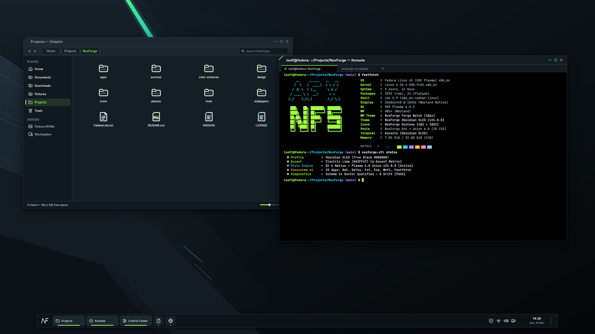
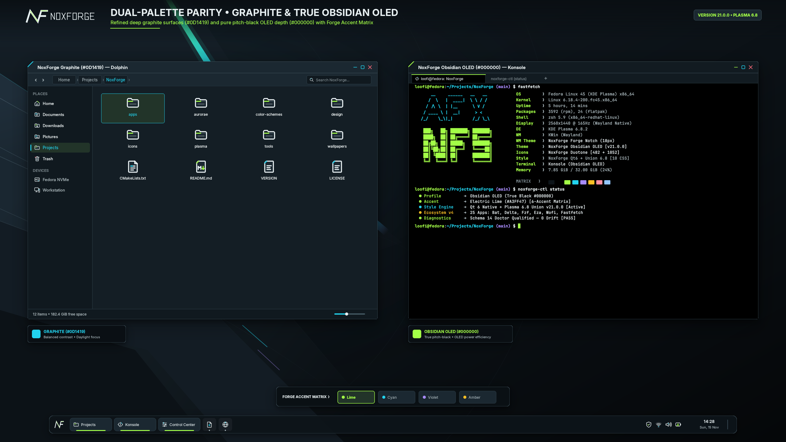
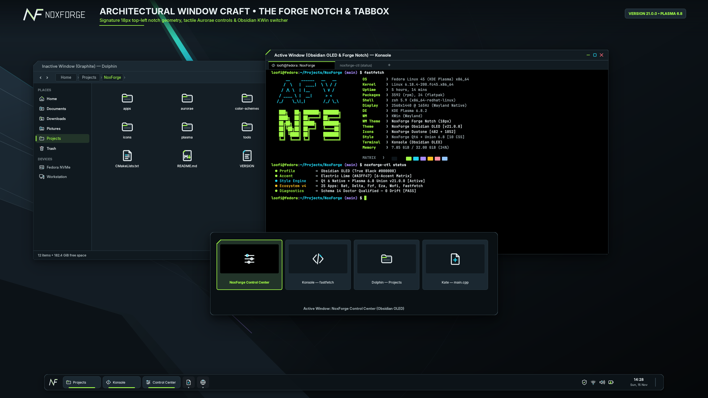
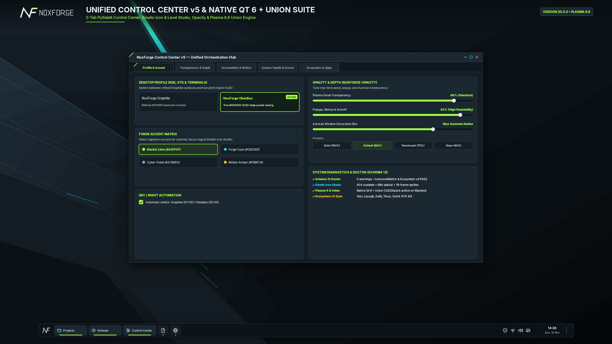
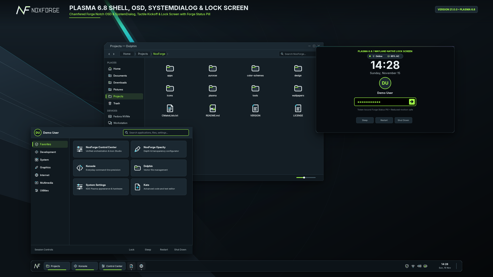
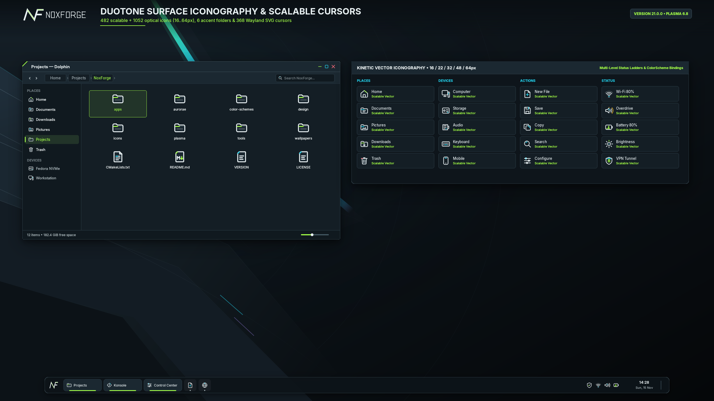
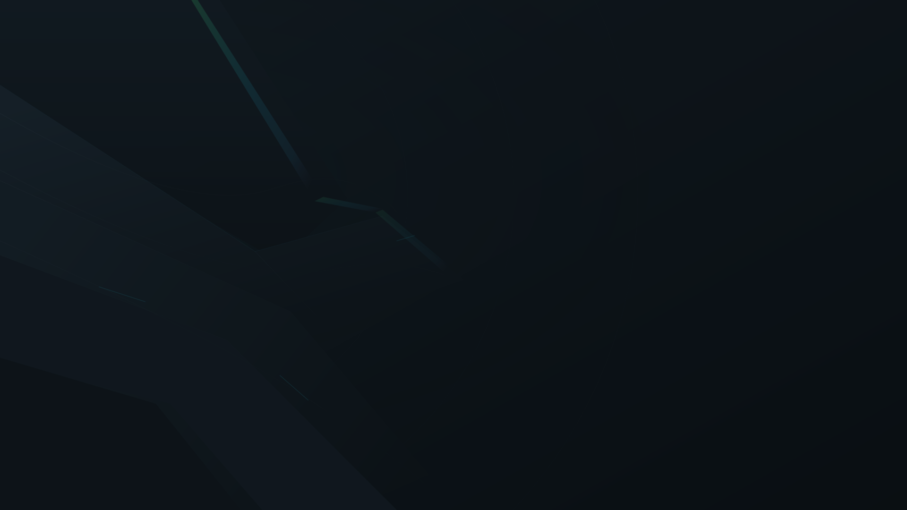

# NoxForge 21.0.0 — Duotone Visual Craft, Aurorae v2, Live Control Core & Ecosystem v4

NoxForge is an original MIT-licensed Plasma visual system: quiet graphite
surfaces, true-black OLED variants, an adaptive 6-accent engine, restrained
detail, and a compact Forge Notch. Version 21.0.0 targets Fedora 44, Fedora 45, and Arch
Plasma/KWin 6.8+ with Qt 6.11 on Wayland. It delivers Duotone Surface iconography
(`482` scalable SVGs + `1,052` optical variants across `16px`–`64px`), Plasma 6
Wayland `cursors_scalable/` + 4× AA Xcursors, Tactile Forge Audio v2, true PNG24
wallpapers with `16:10`/`32:9` & Dynamic `images_dark/`, Aurorae v2 with ambient
shadows & flush maximized frames, Look-and-Feel OSD & SystemDialog QML, a complete
native Qt 6 C++ style + modular Plasma 6.8 Union CSS + deep GTK4/Libadwaita,
Control Center v6 with live hot-reload CLI, Ecosystem v4 (`25` tools incl. Fastfetch
Kinetic Studio v2, `bat`, `delta`, `fzf`, `eza`, `wofi`), Tokens Schema 17, and
Doctor Schema 14 diagnostics.
See the [v21 release plan](docs/NOXFORGE_V21_PLAN.md).



Capture provenance and dimensions are recorded
in [media/manifest.json](media/manifest.json).

## Choose an installation

| Journey | What it includes | Boundary |
| --- | --- | --- |
| Store/component | Independently selectable KDE packages, including Graphite and Obsidian variants | User-local; no native Qt style, login-manager integration, or root |
| Portable | All user-local components, Breeze controls, installer, uninstaller, doctor | No login-manager integration, native plugin, or active-settings write |
| Complete system | Portable content plus adaptive native Qt style and system doctor | PLM wallpaper asset on Fedora; Graphite and Obsidian SDDM themes remain selectable |

Start with [Quick start](docs/QUICKSTART.md), or read the dedicated
[portable](docs/INSTALL_PORTABLE.md), [Fedora](docs/INSTALL_FEDORA.md), and
[Arch](docs/INSTALL_ARCH.md) guides. Package installation never applies a
theme, resets a panel, edits KDE configuration, or restarts Plasma.

## Gallery









Fedora 44 and Fedora 45 use Plasma Login Manager (PLM) by default. NoxForge Quiet is the
recommended PLM wallpaper; NoxForge does not ship or claim a custom PLM QML
greeter and never writes the active PLM configuration. Graphite and Obsidian
SDDM themes are optional compatibility components and are never selected
automatically.

Both SDDM themes and both Plasma lock screens can expose the experimental
LoofiFaceID factor when the matching version-pinned SDDM or KScreenLocker API
is installed. NoxForge does not install or enable biometric authentication;
ordinary SDDM and KScreenLocker continue to use their password paths. See the
[experimental face-authentication integration](docs/EXPERIMENTAL_FACE_AUTH.md).

These images carry explicit capture provenance in the media manifest. They are not a substitute for pending physical input,
cursor, audio, PAM/login, power, and live-session gates.

## Components

- Graphite and Obsidian Global Themes, Plasma Styles, and Aurorae decorations
  with KDE-correct package roots;
- NoxForge Dark and Obsidian colors, matching Konsole themes, Aurorae decoration,
  KWin switchers (Graphite and Obsidian), icons, cursors, and sounds;
- native Plasma 6 / Wayland Lock Screen with kinetic password focus for both
  Graphite and Obsidian look-and-feel packages;
- GTK 3 and GTK 4 themes, Kate/KWrite syntax themes, and VS Code/Cursor editor
  themes in standard and Obsidian palettes;
- KDE Plasma 6.8 Union Style Engine packages (`union/styles/noxforge` and
  `union/styles/noxforge-obsidian`) with hybrid `unionStyle` orchestration and
  optional full Union widget style toggling (`noxforge-ctl union`);
- Zed editor themes, btop monitors, Starship prompt, Plasma 6.8 System Monitor
  telemetry page (`noxforge-telemetry.page`), Discord / Vesktop CSS, and Firefox browser
  theming (`userChrome.css` and extension manifest);
- Ghostty, Alacritty, Kitty, and Foot configurations for both terminal palettes;
- five selectable wallpapers: **NoxForge Forge** (`NoxForge`), **NoxForge
  Quiet** (`NoxForge-Quiet`), **NoxForge Ultrawide** (`NoxForge-Ultrawide`),
  **NoxForge Obsidian** (`NoxForge-Obsidian`), and **NoxForge Obsidian
  Ultrawide** (`NoxForge-Obsidian-Ultrawide`);
- a native Qt 6 style that dynamically adapts to the active NoxForge palette and
  6-accent Forge Accent Matrix (Lime, Cyan, Violet, Amber, Crimson, Ice, or custom hex)
  via `NOXFORGE_ACCENT` and reactive `kdeglobals` watching, paired with modular Plasma 6.8
  `plasma-union` CSS (`union/styles/noxforge*`);
- Duotone Surface & Kinetic iconography engine featuring `482` scalable SVGs (`56` apps,
  `30` distinct mimetypes, `28` duotone & accent places), `1,052` optical icons (`16px`–`64px`),
  16-frame sprite animations, and 8 Plasma Desktop Theme icon sheets per palette;
- dynamic QMenu and menubar layout preventing text truncation across fractional display scales;
- unified orchestration suite: live hot-reload `noxforge-ctl` CLI (with `preset`, `accent --from-wallpaper`,
  and `fastfetch`) and 5-tab PySide6 Control Center v6 (`io.github.loofiboss.noxforge.controlcenter.desktop`);
- `noxforge-opacity` CLI utility and Qt 6 GUI configurator (with seamless Control Center integration)
  for adjusting panel, popup, and Aurorae window decoration transparency levels;
- Developer Ecosystem v4 supporting 25 tools (`bat`, `delta`, `fzf`, `eza`, `wofi`, Fastfetch
  Kinetic Studio v2, Yazi, Lazygit, Zellij, Tmux, Zed, Neovim, Helix, VS Code, Ghostty,
  Alacritty, Kitty, Foot, btop, Starship, Obsidian, Rofi, Discord/Vesktop/Equibop, Firefox/Zen/LibreWolf,
  and Plasma System Monitor);
- read-only edition-aware diagnostics, automated `--apply-sync` alignment (Schema 14),
  and deterministic checksums.

Store descriptions state that components install separately and that the Global
Theme archive is not a complete one-click transaction. Store and portable
defaults use `widgetStyle=Breeze`; system packages use `widgetStyle=NoxForge`.

## Compatibility and rollback

See [compatibility](docs/COMPATIBILITY.md), [troubleshooting](docs/TROUBLESHOOTING.md),
the [control center manual](docs/CONTROL_CENTER_MANUAL.md), the [opacity manual](docs/OPACITY_MANUAL.md),
and the [doctor manual](docs/DOCTOR_MANUAL.md). Always select a known-good
theme and login surface before rollback. Portable removal is file-precise and
RPM/Arch removal touches only package-owned paths.

## Development and evidence

The v21 release scope is recorded in
[NOXFORGE_V21_PLAN.md](docs/NOXFORGE_V21_PLAN.md), indexed by
[IMPLEMENTATION_PLAN.md](docs/IMPLEMENTATION_PLAN.md). Run the release gate with:

```bash
mkdir -p build/baseline-source
baseline_commit=$(python3 -c 'import json; from pathlib import Path; print(json.loads(Path("distribution/release-manifest.json").read_text())["release"]["baseline"]["commit"])')
git archive "$baseline_commit" | tar -x -C build/baseline-source
python3 scripts/release-check.py --baseline-source build/baseline-source
```

Full matrices remain temporary CI evidence; compact manifests and curated
representatives are tracked. See [CONTRIBUTING.md](docs/CONTRIBUTING.md) and
[MANUAL_TESTING.md](docs/MANUAL_TESTING.md) for boundaries.

## License

See [LICENSES.md](LICENSES.md). All NoxForge artwork and generated audio are
original project work.
